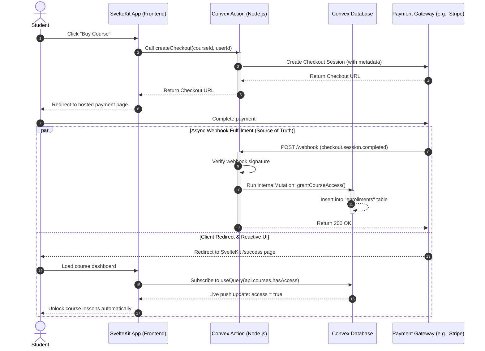
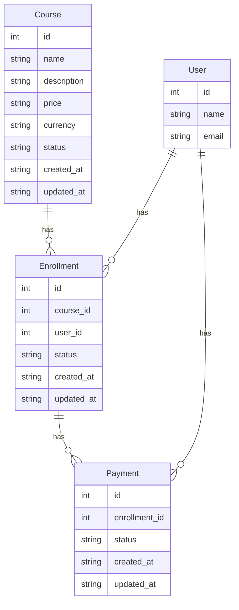

# [Feature Name] Technical Requirements Document

## Metadata

| Feature ID     | {{id}} |
| -------------- | ------ |
| Assignee Email |        |

## Services Used

| Service Name | Description                     |
| ------------ | ------------------------------- |
| SvelteKit    | The frontend of the application |
| Convex       | The backend of the application  |
| Stripe       | The payment gateway             |

## System Architecture

## Data Model

## Externnal API Endpoints

| Method | Endpoint                    | Description                                    | Idempotency Key | Auth required |
| :----- | :-------------------------- | :--------------------------------------------- | :-------------: | :-----------: |
| `POST` | `/v1/payments`              | Creates and processes a new payment charge.    |    Required     |      JWT      |
| `GET`  | `/v1/payments/{id}`         | Retrieves the status and details of a payment. |       No        |      JWT      |
| `POST` | `/v1/payments/{id}/capture` | Captures an authorized payment.                |    Required     |      JWT      |
| `POST` | `/v1/refunds`               | Issues a full or partial refund for a charge.  |    Required     |      JWT      |

## Internal API Convex Functions

| Convex Collection | Convex Function Name | Parameters                             | Description                                    |
| :---------------- | :------------------- | :------------------------------------- | :--------------------------------------------- |
| `payments`        | `createPayment`      | `course_id: number`, `user_id: number` | Creates and processes a new payment charge.    |
| `payments`        | `getPayment`         | `id`                                   | Retrieves the status and details of a payment. |
| `payments`        | `capturePayment`     | `id`                                   | Captures an authorized payment.                |
| `payments`        | `refundPayment`      | `id`, `amount`                         | Issues a full or partial refund for a charge.  |

## Scalability & Performance

| Metric        | Target                                     |
| :------------ | :----------------------------------------- |
| Throughput    | 1000 transactions per second               |
| Latency       | 100ms                                      |
| Rate Limiting | 10 requests per second                     |
| Availability  | 99.99%                                     |
| Scalability   | Vertical (convex single instance)          |
| Performance   | Optimized                                  |
| Cost          | $0.30 per transaction service fee (stripe) |

## Reliability

- Convex single instance
- AWS autoscaling group for convex backend set to min-1 for automatic restarts
- Stripe webhook endpoint
- Payment retries after 10s and after failure with idempotency key

## Testing

- Unit tests for all convex functions using `convex-test`
- Integration tests for all external API endpoints using `supertest`
- End to end tests for the entire payment flow using `playwright`
- Tests using Stripe CLI for webhook verification

## Deployment

- Deployment of infrastructure to AWS using `terraform`
- Deployment to Stripe using `stripe-cli`
- Deployment to Convex using `convex-cli`

## Open Ended Questions

- [Open ended question 1]
- [Open ended question 2]

Example:

- How do we handle the case where a user cancels a payment?
